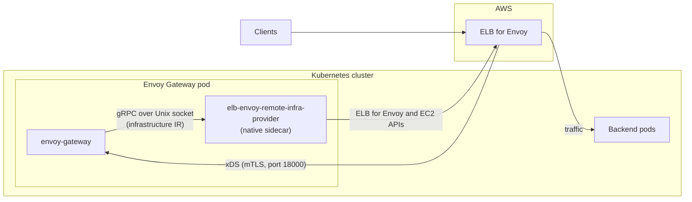

# How it works

Envoy Gateway normally runs Envoy as a Deployment inside your cluster. With `elb-envoy-remote-infra-provider`, Envoy Gateway still does all the Gateway API work, but Envoy itself runs on an AWS managed proxy from Elastic Load Balancing (ELB) for Envoy. The controller is the bridge: it takes the infrastructure Envoy Gateway asks for and creates the matching AWS proxy.

## Components

The following diagram shows how the components connect.



The following table describes each component.

| Component | Where it runs | What it does |
|-----------|---------------|--------------|
| **Envoy Gateway** | Envoy Gateway pod | Watches Gateway API resources, computes Envoy config, and serves it over xDS. Configured with a remote infrastructure provider, so it doesn't create Envoy Deployments itself. |
| **ELB Envoy Remote Infra Provider** | Envoy Gateway pod, as a native sidecar | Receives infrastructure requests from Envoy Gateway and creates, updates, and deletes AWS proxies and security groups. |
| **ELB for Envoy** | AWS | Runs Envoy. Gets its routes and clusters from Envoy Gateway over xDS, and sends traffic to your pods. |

## From Gateway to ELB proxy

1. **You create a Gateway.** Envoy Gateway processes it as usual and builds the infrastructure for it: listeners, ports, and the `EnvoyProxy` settings.
2. **Envoy Gateway calls the sidecar.** Instead of creating a Deployment, Envoy Gateway sends this infrastructure to the sidecar over gRPC on a Unix socket shared in the pod. The sidecar caches it and returns immediately, so Envoy Gateway never waits on AWS.
3. **The controller finds the ELBProxyConfiguration.** Each Gateway needs an [`ELBProxyConfiguration`](guide/overview.md) attached to it. Without one, the controller creates nothing on AWS.
4. **The controller creates AWS resources.** It builds a model of the resources the Gateway needs and deploys it in order:
    1. Security groups
    2. The proxy, with its network settings, AWS Identity and Access Management (IAM) role, tags, and Envoy configuration
    3. A Kubernetes Service that carries the proxy's address
5. **The Gateway gets an address.** When the proxy is ready, the controller writes the proxy's DNS name into that Service's load balancer status. Envoy Gateway picks it up and publishes it as the Gateway's address.

Provisioning a new proxy takes several minutes. While the proxy is being created, the controller checks again every 2 minutes. To follow progress, see [Status and events](guide/overview.md#status-and-events).

## How the proxy gets its configuration

The controller pushes two things to each proxy through the ELB for Envoy API:

- **Bootstrap:** the Envoy bootstrap, built the same way Envoy Gateway builds it for in-cluster Envoy, including any `EnvoyProxy.spec.bootstrap` customization. It points Envoy at Envoy Gateway's xDS server and identifies which Gateway this proxy serves.
- **Config archive:** three things Envoy needs: the TLS client certificate, private key, and CA it uses to connect to Envoy Gateway; the Envoy Gateway pod IPs to connect to, for xDS and for Wasm modules; and the Availability Zones of the proxy's subnets (`local_cluster`), which zone-aware routing needs. Every proxy in the cluster gets the same certificate and key, copied from Envoy Gateway's certs.

After that, the proxy gets routes, clusters, and endpoints live from Envoy Gateway over xDS. It connects directly to the Envoy Gateway pod IPs on port 18000 using mutual TLS (mTLS). For Wasm extensions, it downloads modules from Envoy Gateway's Wasm server on port 18002.

The controller compares hashes and only pushes the parts that changed. A new push happens when:

- Envoy Gateway sends new infrastructure for the Gateway.
- Envoy Gateway's TLS certificates rotate. The sidecar watches the cert files.
- Envoy Gateway pod IPs change.
- The `ELBProxyConfiguration` or a route changes.

## How traffic reaches your pods

The proxy sends traffic directly to pod IPs, using the endpoints Envoy Gateway serves over xDS. This requires pod IPs that are routable in the virtual private cloud (VPC), as with the Amazon VPC CNI.

To allow this traffic, the controller manages the security groups in the following table.

| Security group | Scope | Rules |
|----------------|-------|-------|
| **Frontend SG** | One per Gateway | Allows inbound traffic on each listener port from `spec.ingressCidrs` (default `0.0.0.0/0`, plus `::/0` with IPv6) and `spec.ingressPrefixLists`. |
| **Shared backend SG** | One per controller install (cluster name and controller namespace), attached to every proxy that install manages | Used as the source for the node security group rules below. Each install creates and revokes only its own backend SG and node SG rules, so installs in different namespaces don't interfere. |
| **Node SG rules** | Your existing node security groups | Allows inbound traffic from the shared backend SG on TCP port 18000 (xDS) and TCP port 18002 (Wasm modules), both to Envoy Gateway, and on the target port of every Service the proxy sends traffic to: route backends, request mirror targets, and the `ext_authz` and `ext_proc` services of your `SecurityPolicy` and `EnvoyExtensionPolicy` resources. The two Envoy Gateway ports open as soon as a Gateway exists, before any route does. |

!!! note
    If you bring your own security groups with `spec.networkConfiguration.vpcConfiguration.securityGroups`, the controller uses them as they are. It doesn't create a frontend SG, doesn't add node SG rules, and ignores `ingressCidrs` and `ingressPrefixLists`. You must allow the traffic yourself: from the proxy to Envoy Gateway on port 18000 (xDS), and on port 18002 if you use Wasm extensions, and to your backend pods, request mirror targets, and `ext_authz` and `ext_proc` services on their target ports. See [Security groups](deploy/security_groups.md).

## High availability and leader election

Every Envoy Gateway replica has its own sidecar. All sidecars accept infrastructure from their Envoy Gateway container, but only one, the leader, calls AWS. The sidecars elect a leader with the lease `elb-envoy-remote-infra-provider-leader`.

This is why Envoy Gateway's own leader election must be disabled. With it on, only the Envoy Gateway leader sends infrastructure, so the other sidecars' caches stay empty or stale. If leadership then moves to one of those sidecars, it would act on stale data. With it off, every replica keeps its sidecar up to date, and the sidecar lease picks the single writer.

Disable it in the Envoy Gateway configuration:

```yaml
provider:
  type: Custom
  custom:
    resource:
      type: Kubernetes
      kubernetes:
        leaderElection:
          disable: true
    infrastructure:
      type: Remote
      remote:
        service:
          unix:
            path: /var/run/elb-envoy-remote-infra-provider/server.sock
```

See [Installation Guide Step 4](deploy/installation.md#step-4-install-envoy-gateway) for the full setup. For how Envoy Gateway's leader election and remote infrastructure provider work, see the [Envoy Gateway documentation](https://gateway.envoyproxy.io/docs/).

## Merged gateways

If you enable Envoy Gateway's merged gateways mode, Envoy Gateway sends one set of infrastructure for the whole GatewayClass. The controller then creates **one proxy for all Gateways in the class**. In this mode, only an `ELBProxyConfiguration` that targets the GatewayClass applies.

## Deletion and cleanup

When you delete a Gateway:

1. Envoy Gateway tells the sidecar to delete the infrastructure.
2. The controller removes node SG rules for ports no other Gateway needs. The two Envoy Gateway ports stay open while any Gateway exists.
3. The controller deletes the Service.
4. The controller deletes the proxy and waits until it's gone. It checks every 30 seconds.
5. Then it deletes the frontend SG. The shared backend SG is removed when no Gateway uses it.

An `ELBProxyConfiguration` has a finalizer. You can't delete it while a Gateway still uses it.

## Drift and recovery

- **Every reconcile corrects drift.** The controller compares the live proxy's configuration, attributes, network settings, and tags with the desired state and fixes differences.
- **Some settings replace the proxy.** `name`, `roleArn`, and the IP configuration can't change on an existing proxy. Changing one deletes the old proxy and creates a new one, and the Gateway gets a new address.
- **Restarts.** When a new leader starts and has no infrastructure yet, it finds existing proxies by their tags, so it can keep managing them.
- **Garbage collection.** Every 60 minutes, it looks for proxies whose Gateway is gone, and for orphaned security groups.

## Tags

The controller tags everything it creates so it can find its own resources and so the IAM policy can scope write access. The following table lists the tag keys.

| Tag key | Meaning |
|---------|---------|
| `gateway.elbproxy.aws/cluster` | Cluster name |
| `gateway.elbproxy.aws/stack` | The Gateway (`namespace/name`) or merged GatewayClass that owns the resource |
| `gateway.elbproxy.aws/resource` | Resource type |
| `gateway.elbproxy.aws/managed-by` | Marks the resource as managed by this controller |
| `gateway.elbproxy.aws/controller-ns` | Namespace of the controller install that owns the shared backend SG |
| `gateway.elbproxy.aws/deploy-mode` | Marks resources created for a merged GatewayClass |

You can add your own tags with `spec.tags` on the `ELBProxyConfiguration` or the controller's `--default-tags` flag. When both set the same key, `spec.tags` wins. Keys listed in `--external-managed-tags` are left to other systems on proxies: the controller never adds, changes, or removes them there, and setting one in `spec.tags` is an error. This doesn't apply to security groups. The controller removes any tag it didn't set from the security groups it creates. Don't use keys that start with `gateway.elbproxy.aws/`. See [Configurations](deploy/configurations.md).
